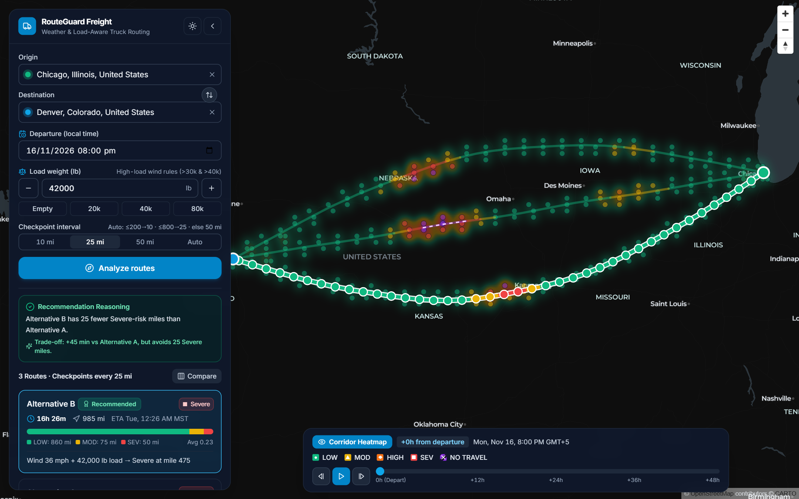
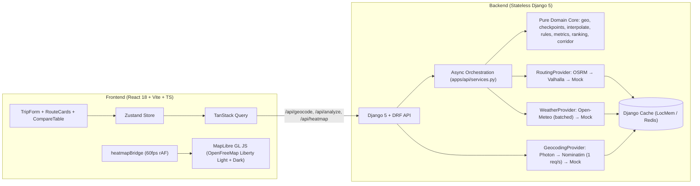
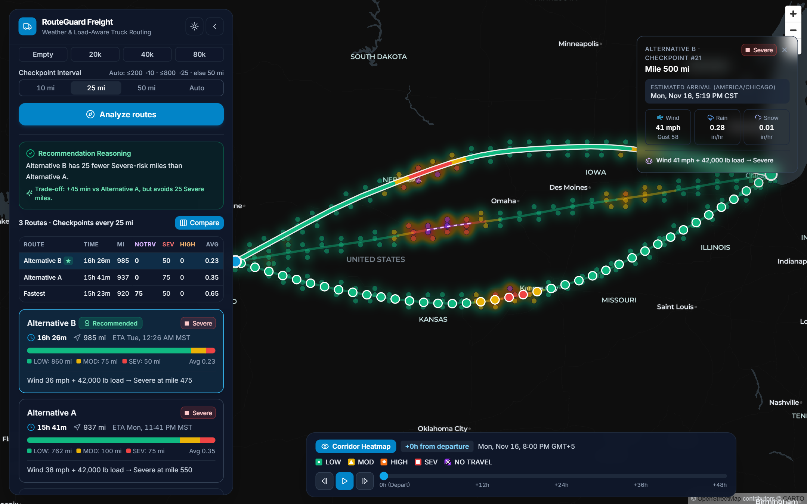
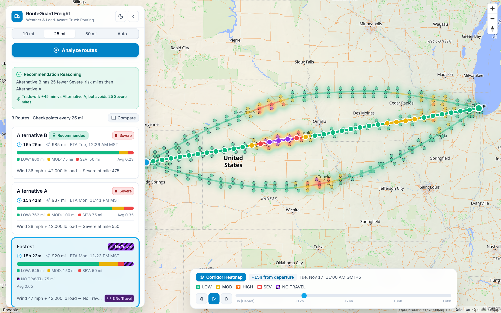

# RouteGuard Freight — Weather-Aware Truck Routing

A production-quality, keyless full-stack web application (**React 18 + Vite + TypeScript + MapLibre GL** and **Django 5 + DRF**) that helps commercial truck drivers and dispatchers choose the safest corridor based on **ETA-interpolated hourly weather**, **trailer load weight**, and **travel time**.



---

## Key Capabilities

1. **Three Distinct Routes Guaranteed:** Queries OSRM (`router.project-osrm.org`) with fallback to Valhalla (`costing: "truck"`) and deterministic mock fixtures. When a router returns fewer than 3 distinct routes, the backend synthesizes perpendicular midpoint via-point detours and deduplicates routes sharing `>85%` geometry overlap, always returning **Fastest**, **Alternative A**, and **Alternative B**.
2. **ETA-Interpolated Checkpoint Sampling:** Walks the full route polyline and places checkpoints at mile `0`, every `10 / 25 / 50` miles (or `Auto`: `≤200 mi → 10`, `≤800 mi → 25`, else `50`), and the destination. Checkpoint ETAs are interpolated from cumulative route leg/step durations by distance—not a constant average speed.
3. **Hourly Weather Interpolation & Timezone Handling:** Fetches batched multi-coordinate hourly forecasts from Open-Meteo and linearly interpolates between the two surrounding UTC hours at each checkpoint's exact ETA. Stores UTC internally and displays each checkpoint's local timezone (`America/Chicago`, `America/Denver`, etc.). Trips extending beyond the forecast window gracefully flag `Forecast unavailable`.
4. **Load-Aware Risk Engine:** Classifies Wind, Rain, and Snow per checkpoint, applies heavy-load wind overrides (`>30,000 lb` and `>40,000 lb`), computes midpoint-to-midpoint distance ownership per risk level, and ranks routes in strict lexicographic order with plain-English trade-off explanations.
5. **60fps 0–48h Corridor Heatmap:** Samples a ~15–25 mi × ±10 mi lateral corridor grid (capped at 300 points) across all 3 routes in a single batched, cached call. The client-side slider scrubs 49 hourly frames inside `requestAnimationFrame` with **zero network refetching**.
6. **Animated Truck Marker & Ghost Fleet:** Renders an inline SVG tractor-trailer marker on the selected route (plus 30%-opacity ghost comparison trucks on the two alternate routes) driven by the 0–48h timeline slider. Precomputes `[cumDistance, cumDuration, lng, lat, bearing]` per vertex once per route from the checkpoint ETA curve (never assuming constant speed) and binary-searches position + shortest-arc heading inside `requestAnimationFrame` at 60fps. Includes a risk-colored status ring/halo, a live floating HUD (local time, miles covered/remaining, wind/rain/snow, risk badge), click-to-open checkpoint popover, and a **Follow truck** camera toggle.

---

## Architecture



### Repository Structure

```text
├── backend/
│   ├── apps/
│   │   ├── routing/       # geo.py, checkpoints.py, providers.py (OSRM/Valhalla/Mock), geocoding.py
│   │   ├── weather/       # interpolate.py, providers.py (Open-Meteo batched + Mock storm cells)
│   │   ├── risk/          # rules.py, metrics.py (midpoint ownership), ranking.py, corridor.py
│   │   └── api/           # services.py, serializers.py, views.py, exceptions.py, urls.py
│   ├── common/            # http.py (shared httpx AsyncClient, 8s timeout, exponential backoff)
│   ├── fixtures/          # places.json, mock_weather.json (reproducible storm cells)
│   └── tests/             # 112 unit & integration tests (pytest + respx)
├── frontend/
│   └── src/
│       ├── features/      # trip-form/, routes/, map/ (MapLibre GL), heatmap/ (60fps slider)
│       ├── components/ui/ # RiskBadge, RiskLegend
│       ├── lib/           # api.ts, risk.ts, format.ts, store.ts, types.ts
│       └── hooks/         # useDebouncedValue.ts
├── docker-compose.yml
├── render.yaml
└── DEMO.md
```

---

## Risk Classification Rules & Boundary Decisions

All lower bounds are **inclusive** unless noted. Sustained 10 m wind (`wind_speed_10m`) drives classification; 10 m wind gusts (`wind_gusts_10m`) are displayed in the checkpoint popover as supporting context.

| Level | Score | Sustained Wind (mph) | Rain (in/hr) | Snowfall (in/hr) |
| :--- | :---: | :--- | :--- | :--- |
| **Low** (`●`) | `0` | `< 25` (`0 – 24.9`) | `< 0.10` (`0 – 0.09`) | `< 0.5` (`0 – 0.49`) |
| **Moderate** (`▲`) | `1` | `25 – < 35` (`25.0 – 34.9`) | `0.10 – < 0.25` (`0.10 – 0.24`) | `0.5 – < 1.0` (`0.50 – 0.99`) |
| **High** (`◆`) | `2` | `35 – < 45` (`35.0 – 44.9`) | `0.25 – < 0.50` (`0.25 – 0.49`) | `1.0 – < 2.0` (`1.00 – 1.99`) |
| **Severe** (`■`) | `3` | `45 – < 55` (`45.0 – 54.9`) | `0.50 – 1.00` (inclusive) | `2.0 – 3.0` (inclusive) |
| **No Travel** (`✕`) | `4` | `≥ 55` (`55.0+`) | `> 1.00` (`1.01+`) | `> 3.0` (`3.01+`) |

### Load-Weight Escalation Rules (only ever raise risk)
Let `base = max(wind_level, rain_level, snow_level)`. Then:
1. **`wind ≥ 55 mph`** → **No Travel (`4`)** for any load weight.
2. **`45 ≤ wind < 55 mph` AND `load_weight_lb > 30,000`** → **No Travel (`4`)** *(e.g. `30,000 lb` stays Severe; `30,001 lb` escalates to No Travel)*.
3. **`35 ≤ wind < 45 mph` AND `load_weight_lb > 40,000`** → at least **Severe (`3`)** *(e.g. `40,000 lb` stays High; `40,001 lb` escalates to Severe; if snow already made `base = No Travel`, it remains `No Travel`)*.

### Route Metrics & Recommendation Order
- **Midpoint Ownership:** Checkpoint $i$ at distance $d_i$ owns $\left[\frac{d_{i-1}+d_i}{2},\, \frac{d_i+d_{i+1}}{2}\right]$ (first starts at `0`, last ends at `total_distance_mi`), ensuring miles per risk level sum to the exact route distance.
- **Strict Lexicographic Ranking** (differences `< 0.5 mi` treated as ties):
  1. Routes with **zero No Travel** checkpoints/miles first *(if all routes have No Travel segments, a high-visibility warning banner is shown and the route with the fewest No Travel miles is recommended)*.
  2. Fewest **Severe** miles.
  3. Fewest **High** miles.
  4. Lowest distance-weighted **average risk score**.
  5. Shortest **travel duration**.

### Animated Truck Position & Heading Derivation (`truckKinematics.ts`)
- **Precomputed Vertex Table:** When an analysis loads, each route's polyline is converted once into an array of `[cumDistanceMi, cumDurationSec, lng, lat, bearingDeg]` tuples. Each vertex's `cumDurationSec` is interpolated from the route's checkpoint `(distance_mi, elapsed_s)` ETA curve so truck speed varies accurately with urban/highway segments rather than assuming a constant average speed.
- **O(log N) Frame Lookup:** At slider hour $h$ ($t = h \times 3600\text{ s}$), `sampleTruckAtTime` binary-searches `cumDurationSec`, linearly interpolates `[lng, lat]` and distance, and interpolates heading along the shortest angular arc (`shortestAngleDelta` in $[-180^\circ, 180^\circ]$) so the icon never spins $350^\circ$ at the $0^\circ/360^\circ$ wrap-around.

---

## Quick Start (Local Development)

### Option A: Native Python + Node (No Docker Required)

**1. Backend (Django 5 + DRF)**
```bash
cd backend
python -m venv .venv
# Windows: .venv\Scripts\activate   |   macOS/Linux: source .venv/bin/activate
pip install -r requirements-dev.txt

# Run the 112 unit & integration tests
pytest

# Start the API server on http://127.0.0.1:8000
# Optional: set USE_MOCKS=1 for deterministic storm fixtures
python manage.py runserver 127.0.0.1:8000
```

**2. Frontend (React 18 + Vite + TypeScript)**
```bash
cd frontend
npm install

# Run Vitest unit tests & ESLint
npm test
npm run lint

# Start Vite dev server on http://127.0.0.1:5173 (proxies /api -> 127.0.0.1:8000)
npm run dev
```

### Option B: Docker Compose
```bash
docker compose up --build
# Frontend served at http://localhost:8080, Backend at http://localhost:8000/api/health
```

---

## Environment Variables (`.env.example`)

No API keys or secrets are needed. All variables are optional overrides:

| Variable | Default | Description |
| :--- | :--- | :--- |
| `USE_MOCKS` | `0` | Set to `1` to force deterministic mock routing, geocoding, and storm cells (great for offline testing & Loom demos). |
| `ALLOW_MOCK_FALLBACK` | `1` | Fall back to simulated fixtures with a clear UI warning banner if all free public servers are down. |
| `OSRM_BASE_URL` | `https://router.project-osrm.org` | Primary OSRM routing endpoint. |
| `VALHALLA_BASE_URL` | `https://valhalla1.openstreetmap.de` | Secondary truck-aware Valhalla endpoint (`costing: "truck"`). |
| `OPEN_METEO_BASE_URL` | `https://api.open-meteo.com` | Hourly weather forecast endpoint. |
| `PHOTON_BASE_URL` | `https://photon.komoot.io` | Primary place autocomplete endpoint. |
| `NOMINATIM_BASE_URL` | `https://nominatim.openstreetmap.org` | Rate-limited (1 req/s) fallback geocoder. |
| `HTTP_USER_AGENT` | `WeatherAwareTruckRouting/1.0 ...` | Descriptive `User-Agent` sent on all upstream HTTP requests. |
| `HTTP_TIMEOUT_S` | `8` | Per-request upstream timeout in seconds. |
| `REDIS_URL` | *(unset)* | Optional Redis cache URL; uses Django `LocMemCache` when unset. |
| `VITE_API_BASE_URL` | `""` | Frontend build-time API origin (empty in dev to use `/api` proxy). |

---

## API Reference

### `GET /api/health`
Returns `200 OK`: `{"status": "ok", "mocks": false}`.

### `GET /api/geocode?q=<query>&limit=5`
Proxies autocomplete queries through Photon → Nominatim → Mock with 24h caching.
- **400** if `q` is shorter than 2 characters.

### `POST /api/analyze`
Request body:
```json
{
  "origin": { "lat": 41.8781, "lng": -87.6298, "label": "Chicago, IL" },
  "destination": { "lat": 39.7392, "lng": -104.9903, "label": "Denver, CO" },
  "departure": "2026-11-16T16:00:00Z",
  "load_weight_lb": 42000,
  "interval": "auto"
}
```
Returns `200 OK` with `routes` (3 routes sorted by recommendation rank, simplified geometries, risk-colored `segments`, `checkpoints` with local `timezone`, `weather`, `levels`, `dominant`, `load_override`, `reason`, and `metrics`) plus `recommendation` (`route_id`, `ranking`, `explanation`, `tradeoff`, `all_have_no_travel`).
- **400** `invalid`: validation error (same origin/destination, invalid load weight, departure >6h in past).
- **422** `no_route`: no drivable route between points.
- **429** `throttled`: per-IP rate limit exceeded.
- **502** `upstream_unavailable`: upstream services unavailable (when `ALLOW_MOCK_FALLBACK=0`).

### `POST /api/heatmap`
Same trip fields (`origin`, `destination`, `departure`, `load_weight_lb`). Returns compact 0–48h corridor grid (`gzip` compressed):
```json
{
  "base_time": "2026-11-16T16:00:00Z",
  "hours": 49,
  "load_weight_lb": 42000,
  "provider": "open-meteo",
  "warnings": [],
  "points": [[41.8, -87.6, [0, 0, 1, 2, 3, ...]]]
}
```

---

## Self-Hosting OSRM & Valhalla in Docker for Production

The public `router.project-osrm.org` and `valhalla1.openstreetmap.de` servers are community-operated demo instances with strict rate limits and no SLA. For production fleet deployment, run your own routing container and point `OSRM_BASE_URL` or `VALHALLA_BASE_URL` at it:

```bash
# Example: Self-hosted Valhalla with US Midwest extract (supports truck height/weight/hazmat costing)
docker run -d --name valhalla -p 8002:8002 \
  -v $PWD/custom_files:/custom_files \
  -e tile_urls=https://download.geofabrik.de/north-america/us-midwest-latest.osm.pbf \
  ghcr.io/valhalla/valhalla-scripted:latest

# Then set in backend environment:
export VALHALLA_BASE_URL=http://localhost:8002
```

---

## Assumptions, Trade-Offs & Known Limitations

1. **Sustained Wind vs. Gusts:** Sustained 10 m wind (`wind_speed_10m`) is used for deterministic threshold classification, while 10 m gusts (`wind_gusts_10m`) are surfaced in the checkpoint popover. Empty/light high-profile vans can also be sensitive to gusts; switching classification to `max(sustained, 0.8 * gust)` is a one-line change in `apps/api/services.py`.
2. **Non-Truck Routing in Public OSRM:** Public OSRM uses a standard car profile (`driving`) and does not model low-clearance bridges or hazmat restrictions. Our `ValhallaProvider` uses `costing: "truck"` as the automatic second provider and can be promoted to primary when self-hosted.
3. **Synthetic Via-Point Detours:** Long interstate queries in OSRM frequently return only 1 or 2 routes. We synthesize additional candidates using perpendicular offsets (`±12%` and `±22%` of route length) at the route midpoint and filter by `>85%` overlap. On peninsulas or constrained mountain passes, detours may rejoin the main highway quickly.
4. **Public Server Rate Limits:** Open-Meteo URL length and rate limits are mitigated by rounding coordinates to `0.05°` (~3.5 mi), deduplicating across routes, batching up to 300 coordinates in a single HTTP call, and caching per `(point, UTC day)` for 30 minutes.

---

## Deployment Guide (Render + Vercel)

1. **Backend on Render (Free Web Service):**
   - Connect the repository in Render and select **Blueprint (`render.yaml`)** or create a Python Web Service with Root Directory `backend`, Build Command `pip install -r requirements.txt`, Start Command `gunicorn config.wsgi:application --bind 0.0.0.0:$PORT --workers 2 --threads 4 --timeout 60`, and Health Check Path `/api/health`.
   - Set `CORS_ALLOWED_ORIGINS` to your Vercel domain (`.vercel.app` and `.netlify.app` are already allowed via `CORS_ALLOWED_ORIGIN_REGEXES`).
2. **Frontend on Vercel (or Netlify):**
   - Import the repo, set Root Directory to `frontend`, Framework Preset to `Vite`, and add environment variable `VITE_API_BASE_URL=https://<your-service>.onrender.com`.
   - Deploy and verify `/api/health` and a full route analysis.

---

## Screenshots

| Compare Table & Checkpoint Popover | Light Mode (OpenFreeMap Liberty) |
| :---: | :---: |
|  |  |
